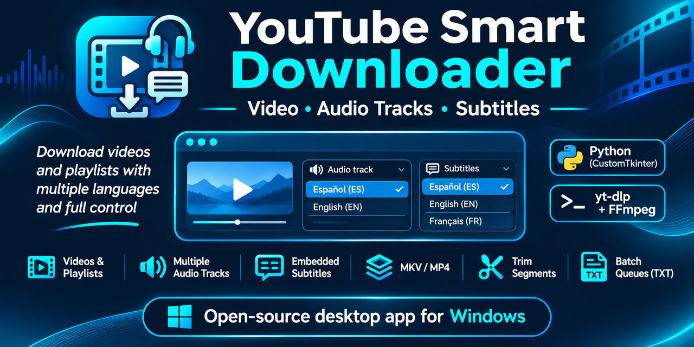

# YouTube Smart Downloader

<p align="center">
  
</p>

**Download YouTube videos and playlists with the audio tracks and subtitles you choose.**

YouTube Smart Downloader is a free, open-source **Windows desktop app** powered by [yt-dlp](https://github.com/yt-dlp/yt-dlp), [FFmpeg](https://ffmpeg.org/) and a graphical interface built with CustomTkinter. Select multiple audio languages, embed subtitles in the same file, choose MP4 or MKV, and process individual videos, playlists or text-file batches.

[](https://github.com/ipeidro-source/youtube-smart-downloader/releases/latest)
[](https://github.com/ipeidro-source/youtube-smart-downloader/releases/latest)
[](https://github.com/ipeidro-source/youtube-smart-downloader/actions/workflows/ci.yml)
[](LICENSE)

**[Download the latest Windows release](https://github.com/ipeidro-source/youtube-smart-downloader/releases/latest)** · [View all releases](https://github.com/ipeidro-source/youtube-smart-downloader/releases) · [Report an issue](https://github.com/ipeidro-source/youtube-smart-downloader/issues)

> **Portable app, not an installer.** Download the Windows x64 ZIP and extract it, or get the standalone `YouTubeSmartDownloader.exe`. No Python installation is needed to run the executable. The external tools yt-dlp, FFmpeg/ffprobe and Deno are **not bundled**; the app checks them at startup and offers installation through winget when available.

## Highlights

| What you can do | How it works |
| --- | --- |
| **Choose your audio languages** | Select, reorder and embed multiple available audio tracks, including regional variants, and pick the default playback language. |
| **Embed subtitles** | Select multiple subtitle languages, prioritizing published captions with optional automatic subtitles. Subtitles are inside the output file, not loose sidecar files. |
| **Use MP4 or MKV** | Keep multiple audio and subtitle tracks in either container; incompatible MP4 codecs are converted as needed. MKV is the default. |
| **Download a video or playlist** | Automatically detect the input and explicitly resolve links that could mean either a video or a playlist. |
| **Process a TXT list** | Import ordered video links from a UTF-8 text file, optionally with a start/end range for each entry. |
| **Download just a segment** | Specify start/end times for individual videos or TXT entries. Fast keyframe-based cuts are approximate. |
| **Control quality and destination** | Choose best available, 1080p, 720p or 480p and optionally group downloads in named subfolders. |
| **Keep track of downloads** | See progress, cancel jobs, resume compatible partial downloads, and review JSON reports and archives. |

**Language availability depends on the source video.** The app reports missing tracks rather than pretending an unavailable language was downloaded. It can skip a video when no requested audio is present, or use an explicitly enabled, unverified fallback. Videos and playlists must be downloaded only when you have the necessary rights or permission.

## Quick start on Windows

1. Open the **[latest Release](https://github.com/ipeidro-source/youtube-smart-downloader/releases/latest)** and download `YouTubeSmartDownloader-<version>-Windows-x64.zip` (recommended), then extract it. A standalone `YouTubeSmartDownloader.exe` is also provided.
2. Launch `YouTubeSmartDownloader.exe`. Because the executable is currently unsigned, Windows SmartScreen may ask you to check its origin.
3. Follow the startup checks for **yt-dlp, FFmpeg/ffprobe and Deno**. If necessary, install them manually or via the application's winget-assisted flow. You need Windows, and winget plus an internet connection for automated installation. After changing PATH, restart the application.
4. Paste a YouTube video or playlist URL, or click **Import links...** for a TXT batch. Select the audio languages, subtitles, preferred audio, quality, output format and destination, then click **Download**.

The app runs locally, but downloading and dependency checks require network access. Read [Privacy](docs/PRIVACY.md), [Known limitations](docs/LIMITATIONS.md), and [Uninstallation](docs/UNINSTALL.md) for details. Linux CI tests shared Python logic; **Windows is the supported desktop platform**.

## For developers and contributors

This project uses Python 3.11+, CustomTkinter, yt-dlp, FFmpeg, automated tests, Ruff, mypy and GitHub Actions. The Windows portable executable is generated and verified in CI, then published in tagged Releases. You can find the commands under [Development](#development) and the release checks under [CI and releases](#ci-and-releases).

Author and copyright holder: **ipeidro** ([@ipeidro-source](https://github.com/ipeidro-source)). Source code: [MIT License](LICENSE). Not affiliated with YouTube or Google. For technical details, see [Audio and subtitle selection](#audio-and-subtitle-selection), [Input files](#input-files), and [Architecture](#architecture).

## Input files

TXT files use UTF-8 (a BOM is accepted), one YouTube video URL per line. Blank lines and lines beginning with `#`, `;` or `]` are ignored. Playlists and ambiguous video/playlist links are rejected inside TXT files. Invalid lines and duplicate videos are listed before importing; no URLs are silently discarded. Imported videos use one ordered queue, one destination and one session report. When **Create a subfolder for the source** is checked, all imported videos share a folder named after the TXT file without its extension. Importing a file does not add support for other video providers.

For a single video, optional **Start** and **End** fields select a time range. Enter whole seconds,
`MM:SS` or `HH:MM:SS` (for example `90`, `01:30` or `01:02:30`); minutes and seconds in
colon-separated values must be between 0 and 59. A blank start means zero; a blank end means
the end of the video. Both blank downloads the whole video. Times reset when the source changes
and are not saved as preferences. Time parameters in URLs are not used as download ranges.

TXT lines accept either a URL alone or exactly three semicolon-separated columns,
`URL;start;end`, with optional surrounding spaces:

```text
https://www.youtube.com/watch?v=abcdefghijk
https://www.youtube.com/watch?v=abcdefghijk;01:30;03:00
https://www.youtube.com/watch?v=abcdefghijk;01:30;
https://www.youtube.com/watch?v=abcdefghijk;;03:00
```

Each line requests one output file. Different ranges of the same video are allowed; duplicates
are detected by normalized video URL and range (`90` and `01:30` are equivalent). Invalid lines
are reviewed before import. Ranges outside the video duration, and ranges for videos with an
unknown duration, fail individually without stopping the remaining queue.

Cuts use yt-dlp's `--download-sections` and FFmpeg without forcing keyframes or additional
recoding for the cut. **Fast cuts may differ from the requested times due to keyframes.**
MP4 output may still require conversion of incompatible codecs. Playlists always download
whole videos; range fields are disabled for playlists and TXT imports (TXT ranges come from
the file). If an ambiguous link is resolved as a playlist, clear any entered times before starting.

## Development

Python 3.11+:

```powershell
py -m venv .venv
.venv\Scripts\Activate.ps1
pip install -r requirements-dev.txt -e ".[dev]"
python -m youtube_smart_downloader
pytest -q
ruff check .
ruff format --check .
python -m mypy
```

Build and check the Windows executable:

```powershell
python scripts/build_windows.py
python scripts/check_windows_exe.py
python scripts/smoke_windows.py
python scripts/package_release.py
```

The executable is written to `dist/YouTubeSmartDownloader.exe`. Its product name, author/CompanyName (`ipeidro`), description, copyright, internal/original filename, project/support links and versions are generated from `pyproject.toml`. Both numeric and readable PE versions are validated against the runtime version.

The build embeds and copies license, privacy and uninstallation documents. It collects installed third-party license texts without a network request. The startup smoke test creates a hidden UI, runs the event loop and checks CustomTkinter resources. It does not install/update tools, query update services, download videos or save preferences. Packaging adds a portable ZIP and SHA-256 hashes of the final executable and ZIP.

The blue/cyan video-and-audio icon is shared by the window and executable. Its source and export instructions are in [assets/README.md](assets/README.md).

Close the executable before rebuilding it. Keep the current local executable at `dist/YouTubeSmartDownloader.exe`; avoid accumulating preview copies. Build intermediates are generated under `build/` and can be removed after validation. The build and packaging commands create local artifacts only; they do not publish a release.

The integration tests in `tests/test_local_media.py` require yt-dlp, FFmpeg and ffprobe on PATH. They serve synthetic media on `127.0.0.1`, check the decoded audio and test HTTP range resumption without contacting YouTube. They are skipped if the tools are unavailable. `tests/test_language_picker.py` additionally checks repeated keyboard searches and popup dismissal on a Windows desktop; it is skipped on Linux.

## Audio and subtitle selection

Configure requested languages before downloading. The same preferences apply to every video in a playlist or TXT batch; they do not claim that those languages exist. Choose languages by name and code from searchable dropdowns with mouse-wheel scrolling, then add/remove and reorder them in the two compact lists. Mark the preferred playback audio with **Set default**; an asterisk identifies it. New preferences start with Spanish (Spain) as the default audio and English (any region) second, plus Spanish and English subtitles. Explicit saved selections are preserved; the legacy Spanish-only setup adopts these initial language lists. If that audio is absent, the first available requested audio becomes the default. Requests resolving to the same audio track are deduplicated. The log and report identify YouTube's original/default audio separately, with its verification status.

Missing languages produce warnings rather than discarding the available tracks. The skip/fallback choice applies only when none of the requested audios is available. MKV is the default; MP4 is also available with one or multiple audios and subtitles. The chosen container is respected regardless of the number of available tracks. Compatible video/audio streams are copied; unsupported MP4 codecs are converted to H.264/AAC as needed.

Subtitles are optional and embedded as selectable SubRip (MKV) or `mov_text` (MP4) tracks. No external subtitle files are published. Published subtitles take precedence; **Allow automatic subtitles** permits extractor-provided automatic captions or translations when published subtitles in that language are unavailable. Live chat is excluded. For clips, cues are clipped to the interval and their timestamps start at the beginning of the fragment. A failure to download or embed a selected available track fails that video and retains its temporary work.

Subtitles are not marked forced. MKV subtitle tracks are explicitly non-default. MP4's FFmpeg muxer enables its first subtitle track so players can list it, even with a zero default disposition; automatic display ultimately depends on the player and its language preferences.

## Audio-language guarantees

Language verification refers to extractor metadata, not speech recognition. `es-ES` requires that exact regional tag; generic `es` cannot prove that a track is from Spain. Original audio uses an explicit extractor marker when available; otherwise the choice is unverified. A fallback never verifies the originally requested language.

Only independent video and audio streams are used. Combined-only formats are skipped to avoid changing the selected audio silently. The download uses a snapshot of the inspected metadata and exactly the chosen tracks. If signed media URLs expire, retry to obtain new metadata. Active live streams are not supported.

`Spanish (Spain)` is strict: it does not fall back to Latin American Spanish. `Spanish (any region)` selects one matching Spanish track by reported bitrate, without prioritizing Spain. Adding both requests independent tracks; list order does not define a regional fallback chain.

## Files and resumption

- `.ytsd-archive.txt` records provider and video ID in yt-dlp-compatible format. The application updates it atomically after validating and publishing the media file. Only YouTube is supported. An archived ID represents a video, not an audio/subtitle, format or quality variant; use a separate destination for another variant. Existing archive entries are respected without certifying old files or their language.
- `.ytsd-clips.txt` separately records video IDs and normalized ranges after successful validation and publication. Whole-video entries do not skip clips, and clips do not skip whole videos. Clip filenames and temporary-work identities include their range; the report records requested start/end seconds. Clip archive entries also do not distinguish track, format or quality variants. Cuts are verified against the requested clip duration with a tolerance of the greater of two seconds or 5%.
- **Create a subfolder for the source** applies to every input: the video title, playlist title or TXT filename without its extension determines the folder name. Names are sanitized for Windows. When unchecked, all files go directly into the selected destination. Playlist and TXT entries do not get additional per-video subfolders.
- `.ytsd-work` holds partial files and metadata snapshots, identified by video and selected tracks. Retry with the same destination and track selection. Queue-index changes do not move the partial files. When subfolders are enabled, a changed video/playlist title or TXT filename changes the destination; select the previous folder and disable automatic subfolders to reuse its partials. Partial files from older versions that did not create video/TXT subfolders remain in their original location.
- Metadata snapshots contain media URLs and are deleted with the work directory after success. Interrupted jobs keep them locally.
- ffprobe checks the container, one video stream, the selected audio/subtitle stream counts, language tags, default audio and duration before publication. Existing destination files are never overwritten. Invalid staged media files are regenerated. This check does not replace full decoding or listening to the audio.
- Reports use schema version 3 and include requested/included/missing audio and subtitle languages, manual/automatic subtitle provenance, the default audio index, effective container and session impersonation preference. Existing single-audio diagnostic fields are retained.
- Each session keeps a JSON report in `.ytsd-reports`; `download-report.json` is the latest session. Reports distinguish new downloads, archived videos, skips, failures and cancellation. Older `informe-descarga.json` reports are left untouched.
- Technical `video_format` and `audio_format` IDs remain available for diagnostics; additional details describe the source codecs, resolution, FPS, language, bitrate and channels where metadata provides them. MP4 conversion can change the output codecs.

The track list order is preserved in the file. Subtitle tracks are optional; at least one audio language must remain selected.

## Browser impersonation

The **Impersonation** selector sits beside quality, format and missing-audio behavior. **Automatic** (default) leaves networking decisions to yt-dlp. Available browser families are detected from the installed yt-dlp without a network request; selecting Chrome, Edge, Firefox or another listed browser forces that family for metadata, media and subtitles. Versions and operating systems are selected by yt-dlp from its installed profiles. This does not use browser accounts, cookies or personal profiles. Saved choices persist; a forced profile that is no longer available stops with a clear error instead of silently changing behavior. Builds without impersonation support can still use Automatic. Forcing impersonation can affect speed/stability.

## Tool checks and updates

Local checks execute each tool's version command with a timeout. Update checks run in the background, use a short-lived local cache, and query only the three relevant winget packages. Package metadata is not proof that an unrelated executable earlier on PATH was updated. Manually installed or unrecognized versions are reported as having unknown update status; working local tools remain usable. Installation and updates always require confirmation and affect only the listed packages.

## CI and releases

Pull request commits run Ruff, mypy, the full test suite and a Windows build/startup check. Windows tests cover Python 3.11, 3.12 and 3.13; a secondary Linux run covers Python 3.12 on the explicit `ubuntu-24.04` image. GitHub JavaScript actions use Node.js 24; that runtime belongs to CI and is not an application dependency. CI installs yt-dlp and FFmpeg/ffprobe and verifies their presence so the offline media integration tests are exercised rather than silently skipped. `requirements-ci.txt` pins the CI media test dependency alongside the development toolchain.

A push to `main`, including a merge, validates the integrated code and generates its executable artifact. Feature-branch push runs are omitted to avoid duplicating PR checks. Approval alone does not publish a release or merge code. Tags matching `v*` must agree with both package version declarations and reference a commit integrated into `main`. The release workflow reuses the complete CI workflow and publishes its tested Windows artifact only after all jobs succeed. No tag or release is created automatically by merging a PR. The same build/startup scripts are used locally and in CI. `requirements-dev.txt` pins the validated Python toolchain.


## Architecture

- `core.py`: preferences, track resolution, quality and download argument policies.
- `languages.py`: language names for the pickers and container language tags.
- `language_picker.py`: bounded language popups with keyboard search and mouse-wheel scrolling.
- `subtitles.py`: subtitle cue clipping and timestamp adjustment.
- `inputs.py`: input classification and TXT validation.
- `engine.py`: queue planning, metadata and download orchestration.
- `processes.py`: cancellable subprocess execution.
- `tools.py`: local dependency checks, winget update discovery and maintenance.
- `storage.py`: atomic reports, archive and output publication.
- `app.py`: English CustomTkinter UI and worker/event coordination.
- `settings.py`: preference validation and migration under `%APPDATA%/YouTubeSmartDownloader`.
- `requests.py`: video requests and validated whole-second time ranges.
- `about.py` and `release_metadata.py`: application identity, notices and build metadata.

Compatibility code retains the legacy single-language API and `playlist_subfolder` setting so older preferences and MP4 work files can still be used. The removed video/playlist `mode` setting is discarded; input type is inferred from the URL.

See [LIMITATIONS.md](docs/LIMITATIONS.md) for remaining limits and privacy details.

## Licenses and contribution

The application source is [MIT licensed](LICENSE), copyright (c) 2026 ipeidro. This project is not affiliated with YouTube or Google. [Third-party components](docs/THIRD_PARTY.md) retain their licenses; full installed license texts are embedded in the executable and included in the portable ZIP. External tools retain their own licenses: [yt-dlp](https://github.com/yt-dlp/yt-dlp), [FFmpeg](https://ffmpeg.org/legal.html) and [Deno](https://deno.com/). Review the conditions of the actual binaries before redistribution.

Report bugs with reproducible steps. Include tests for changes to audio selection and download behavior. Never commit credentials, session cookies or downloaded videos.
